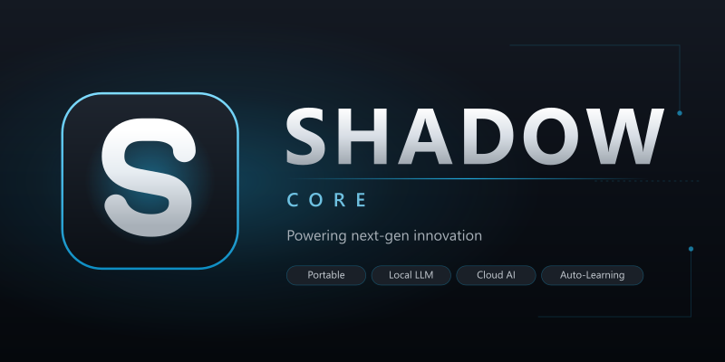

<p align="center">
  <a href="https://shadow.ai">
    
  </a>
</p>

<p align="center"><strong>Agente de desktop autônomo para desenvolvimento, produtividade e segurança — 100% portátil, com inferência local e em nuvem.</strong></p>

<p align="center">
  
  
  
  
  
</p>

---

## 🦀 Arquitetura Oficial: Casca Nativa em Rust & Tauri v2

O **Shadow Core** opera com uma arquitetura de alta performance desenvolvida em **Rust com Tauri v2** e renderização via **Microsoft Edge WebView2 nativo**. A aplicação é 100% auto-contida, sem runtime pesado de navegador embutido e com inicialização determinística sem flash de tela.

### ⚡ Métricas e Especificações de Performance

| Métrica / Recurso | Especificação Nativa | Benefício |
|---|---|---|
| **Tamanho do Pacote** | **52,3 MB** (instalador portátil auto-contido) | Download leve e portátil |
| **Consumo de Memória (RAM Inativa)** | **~85 MB** (processo Rust + WebView2) | Quase zero impacto no sistema |
| **Tempo de Inicialização (Cold Start)** | **< 300 ms** com pré-renderização em memória | Abertura instantânea |
| **Inicialização Visual** | **Zero flash** (exibição determinística via `app-ready`) | Experiência visual fluida |
| **Motor de Renderização** | **Microsoft Edge WebView2 (Evergreen)** | Desempenho e segurança nativos |
| **Painel Lateral Docked** | **Janela magnetizada em Rust (<10ms)** | Acoplamento dinâmico à janela principal |
| **Navegação Web Integrada** | **`WebviewWindow` nativa dedicada** | Suporte irrestrito a portais modernos |
| **Lógica Administrativa & IA** | **`@shadow-ai/admin-core` 100% desacoplado** | Módulos puros em TypeScript |
| **Zero Python** | **100% nativo** (Rust, C++, TypeScript e WASM) | Zero dependência de runtimes externos |

---

## 🗺️ Roadmap de Plataformas

| Plataforma | Status | Formato / Runtime Planejado |
|---|---|---|
| **Windows 10 / 11 (x64)** | **✅ Disponível (Produção Oficial)** | Pacote Portátil ZIP (`Shadow.exe` + WebView2) |
| **Linux (Ubuntu & Debian)** | **⏳ Em Desenvolvimento (Roadmap Futuro)** | Pacotes `.deb` e `AppImage` portáteis nativos (WebKitGTK 4.1) |
| **Android** | **📱 Planejado (Roadmap Futuro)** | APK nativo via Tauri Mobile v2 + Mobile Companion PWA |
| **macOS** | **🔍 Sob Avaliação Técnica** | Pacote `.dmg` nativo via WebKit / Cocoa |

---

### 🔑 Principais Inovações da Arquitetura Tauri 2

1. **Executável Ultra Compacto (52,3 MB):** O binário final portátil (`build-tauri2/Shadow.exe`) tem apenas 52,3 MB, rodando sem necessidade de instalador e sem deixar rastros no Registro do Windows.
2. **Inicialização sem Flash de Tela:** A janela é instanciada com `"visible": false` em `tauri.conf.json`. O backend em Rust escuta o evento `app-ready` emitido pelo frontend quando os estilos e o DOM estão prontos, exibindo a janela imediatamente sem oscilações visuais.
3. **Janela Docked Sidecar Magnetizada (`toggle_panel_window`):** O botão "Painel" aciona um comando Rust nativo que calcula a posição exata da borda direita da janela principal (`x + width, y`) e magnetiza o painel lateral em tempo real. A janela intercepta o evento `CloseRequested`, mantendo-se oculta em memória para reabertura instantânea (<10 ms).
4. **Navegação Web Nativa sem Bloqueio de Framing (`open_browser_window`):** Para contornar a limitação de portais que emitem `X-Frame-Options: SAMEORIGIN` (como Google e GitHub), o Rust instancia janelas nativas dedicadas via `tauri::WebviewWindowBuilder`, com injeção de flags Chromium seguras (`--disable-web-security`).
5. **Novo Pacote `@shadow-ai/admin-core`:** Todos os 58 módulos administrativos (banco de dados SQLite Drizzle, orquestrador GGUF, engine cronjob, sandboxes de segurança, RAG e integrações) foram extraídos para um pacote puro em TypeScript, isolado do ciclo de vida gráfico.
6. **Ponte Reativa de Compatibilidade (`tauri-bridge.ts`):** O frontend em SolidJS continua consumindo o contrato canônico `window.api`, traduzido de forma transparente para invocações `invoke()` do Tauri sem necessidade de reescrever as telas do painel.

---

## 🚀 O que é o Shadow

O **Shadow** é um agente de desktop **portátil** (roda a partir de qualquer pasta — sem necessidade de instalação) que combina:

- 🖥️ **Inferência local** via `llama-server` (GGUF na GPU) + **nuvem** (Anthropic, OpenAI, Groq, Google, Mistral, Cohere, xAI e mais)
- 🧠 **Aprendizado contínuo** — captura correções, novas técnicas e "lembre-se disso" de cada conversa
- 🛡️ **Guarda de execução** com sandbox 2FA para comandos arriscados
- 🔗 **Coordenação com outros agentes de código** (Claude Code, Cursor, Codex e CLIs compatíveis)
- 🤖 **Automação real de navegador** (Playwright) para captura automática de OAuth, cadastros e scraping
- 📦 **Plugins de produtividade** — E-mails, Calendário, Documentos (PDF/Word/Excel), Mercado Livre
- ⚡ **Zero dependência de Python** — ferramentas nativas compiladas ou executadas via TypeScript/WASM

---

## ✨ Módulos Principais

### 🧠 Inteligência
| Recurso | Detalhes |
|---|---|
| **Motor Llama-server (5 Slots)** | Ciclo de vida de processo nativo, descarrega a VRAM da GPU automaticamente quando inativo, 5 slots dedicados simultâneos (portas 11434 a 11438) |
| **Roteamento de IA** | 3 modos (100% local / híbrido / 100% nuvem) com cascata de fallback para até 5 modelos |
| **RAG SQLite FTS5** | Fragmentação semântica (chunking) + busca híbrida (BM25 + cosseno vetorial com RRF) |
| **Aprendizado contínuo** | Loop pós-interação detecta sinais, corrige skills e salva o aprendizado em `memory/` |
| **Skills geradas** | O sistema cria e edita suas próprias skills; o painel exibe o inventário em tempo real |

### 🛡️ Segurança
| Recurso | Detalhes |
|---|---|
| **Sandbox 2FA** | Comandos arriscados (`git push --force`, `rm -rf`) aguardam aprovação remota via Telegram/celular |
| **Interceptador Pré-voo** | Bloqueia comandos destrutivos do SO na raiz (`format`, `diskpart`, `rmdir /s /q C:\`) |
| **Criptografia Nativa** | Credenciais (tokens OAuth, senhas) protegidas via DPAPI do Windows |
| **Auditoria** | Tabela de execução com pontuações de risco em cores e trilha de auditoria completa |

### 🔗 Integrações
| Recurso | Detalhes |
|---|---|
| **Canais de mensagens** | Telegram · WhatsApp · Discord · Slack · Teams · Signal · Instagram · Messenger · X · LinkedIn |
| **Contas de e-mail** | Gmail · Outlook · Yahoo · iCloud · IMAP · webhook personalizado (múltiplas contas) |
| **Calendário unificado** | Google Agenda · Outlook · Teams · iCal (múltiplas contas) |
| **Mercado Livre** | Plugin de Vendas: pesquisa de preços, upload de fotos, textos gerados por IA, publicação via API |
| **Automação de navegador** | Chromium/Firefox/WebKit via Playwright — Captura automática de OAuth, cadastros, scraping |
| **Extensão Obsidian** | Sincronização contínua com Vault Obsidian (`Diários`, `Aprendizados`, `Notas`, grafo neural) |

### ⚙️ Operações
| Recurso | Detalhes |
|---|---|
| **Verificação de saúde** | Diagnóstico em um clique do workspace, skills, DB e memória |
| **Heartbeat** | Registra sinais de rotina periódicos em `HEARTBEAT.md` |
| **Cron autônomo** | Engine em TypeScript com persistência JSON (`data/cronjobs.json`) sem qualquer dependência de Python |
| **Mobile Companion PWA** | Servidor HTTP na porta `18765` para controle por smartphone através da rede local (LAN) |

---

## 🌟 O que Está Ativo no Novo Shadow.exe (Versão Oficial Tauri 2)

O executável portátil de produção (`build-tauri2/Shadow.exe` — 52,3 MB) inclui o mais recente pacote de inovações:

### 1. 🛡️ Protocolo Shadow (Enxame de Sub-Agentes Autônomos) & Onboarding do Operador
- **Identificação do Operador no Primeiro Acesso:** Ao inicializar pela primeira vez, o Shadow apresenta modal interativo elegante no padrão *Shadow Navy Glassmorphism* para registrar como o operador deseja ser chamado. O nome é gravado no perfil pessoal (`USER.md`) e injetado em todas as IAs e sub-agentes, garantindo comunicação personalizada e precisa.
- **Protocolo Shadow (Líder Supremo + Especialistas):** Preset nativo de enxame (`shadow_preset`) que carrega e orquestra simultaneamente uma equipe tática de 8 agentes com papéis complementares:
  - 🔵 **Shadow** — Comandante Central, Governança e Guardião do Operador.
  - 🔷 **J.A.R.V.I.S.** — Arquiteto de Sistemas, Planejamento Estratégico e Decomposição de Tarefas.
  - 🟢 **F.R.I.D.A.Y.** — Execução Tática de Código, Hot-fixes, Refatoração e Compilação Incremental.
  - 🟣 **E.D.I.T.H.** — Segurança Defensiva, Controle de Acessos, Infraestrutura e Observabilidade.
  - 🔴 **U.L.T.R.O.N.** — Pentest Ofensivo/Defensivo, Dissecação de Binários e Engenharia Reversa Profunda.
  - 🟡 **VISÃO** — Consciência Sintética, Deep Research e Radar de Novas Tecnologias.
  - 🤖 **DUM-E** — Braço Hidráulico do MIT: Manutenção do Shadow, Scripts BAT/PS1 e Scanners de Integridade.
  - 🦾 **U (Dos)** — Braço Hidráulico do MIT: Limpeza do Windows, Caches de Navegadores (Chrome/Edge/WebView2) e Otimização do Host.
- **Catálogo de 165 Sub-agentes:** Amplo ecossistema de especialistas com execução isolada em background (`task`) e suporte a Git Worktrees para evitar conflitos concorrentes de código.

### 2. 🏛️ Cockpit Executivo Unificado (Shadow Navy Glassmorphism)
- **Model Matrix & Playground:** Esteira visual de failover em 4 slots (*Triagem ➔ Flagship ➔ Nuvem Alternativa ➔ Local Offline*) com simulação de tolerância a falhas, ping em tempo real e comparador de modelos lado a lado com medição de tokens/segundo e latência em milissegundos.
- **Central de Plugins & MCPs:** Marketplace com **294 plugins portáteis** e **65 servidores MCP**, com o *Plugin Inspector Drawer* para auditoria de permissões e manifestos `plugin.json`.
- **Agent Command Hub (145 Subagentes):** Grafo DAG do Ultraplan para execução paralela, telemetria de especialistas e botão **"Preset ChatDev 2.0"** (orquestração simultânea de CEO, CPO, CTO, Programmer, QA Engineer e Security Reviewer).
- **Gestão Multimídia & Permissões:** Medidor VU Meter dinâmico de decibéis para microfones (USB/Bluetooth), teste de alto-falantes com `setSinkId`, preview espelhado de webcam e gravação permanente de decisões de permissão no disco.

### 3. ⚡ Motores Nativos em TypeScript (Zero-Python Law)
- **Engine Nativa de Cronjob:** Agendamento autônomo com persistência JSON em `data/cronjobs.json`, validação de expressões cron de 5 campos e intervalos ("30m", "every 2h"), dispensando completamente runtimes legados de Python.
- **Re-ranking Matemático UltraRAG 3.0:** Busca semântica profunda com *Reciprocal Rank Fusion (RRF)*, combinando 70% de similaridade densa vetorial com 30% de precisão léxica em identificadores e caminhos de arquivos.
- **Seletor de Sessões SSH/Tmux (`rtmux`):** Acesso rápido a servidores e sessões tmux ativas diretamente na aba SSH do Painel do Sistema (`panel.tsx`).

### 4. 🦙 Local Multimodal Hub (5 Slots GGUF) & Áudio Neural Offline
- **Hub Multimodal com 5 Slots Simultâneos:** Execução paralela e independente de modelos locais GGUF em 5 slots dedicados (portas automáticas `11434` a `11438`) com endpoints compatíveis com Ollama e OpenAI (`http://localhost:11434/v1`).
- **Carregamento Local Idêntico & Flexível:** Seleção direta de `.gguf` no Windows Explorer, alocação granular de VRAM/RAM e telemetria de hardware em tempo real (GPU Vulkan x64, VRAM e CPU por núcleo lógico).
- **Voice & Audio Studio 100% Offline (TTS & STT):**
  - **Piper Neural TTS (ONNX):** Síntese vocal de alta fidelidade em português brasileiro (`pt_BR-faber-medium.onnx`) com RTF < 0.2 (Real-Time Factor ultra veloz), sem necessidade de internet e sem Python.
  - **Windows SAPI:** Síntese em memória via streams diretos com latência imediata.
  - **Reconhecimento de Fala (STT):** Transcrição contínua e processamento de comandos de voz em tempo real.

---

## 📁 Estrutura Oficial do Projeto (Tauri 2 & Workspace)

As capacidades do Shadow seguem a arquitetura de **pastas irmãs no mesmo nível**, preservando `workspace/` exclusivamente para a alma e subagentes:

```
Shadow-Core/
├── packages/
│   ├── tauri-desktop/                  # Casca nativa em Rust (Tauri v2) + WebView2
│   │   ├── src-tauri/                  # Código Rust (lib.rs, main.rs, tauri.conf.json)
│   │   └── src/                        # tauri-bridge.ts, painel acoplado e inicialização
│   ├── admin-core/                     # 58 módulos administrativos e serviços de IA
│   ├── app/                            # Frontend em SolidJS (painéis, cockpit, páginas)
│   ├── ui/                             # Design System oficial Shadow Navy Glassmorphism
│   ├── shadow/                         # Servidor sidecar Node e ferramentas nativas
│   └── protocol/                       # Protocolos de comunicação e esquemas
├── workspace/                          # Identidade, alma, agentes e habilidades
│   ├── SOUL.md, IDENTITY.md, USER.md  # Identidade e contratos
│   ├── AGENTS.md, TOOLS.md            # Regras mestras operacionais
│   ├── MEMORY.md                      # Índice curto sempre ativo no contexto
│   ├── HEARTBEAT.md, BOOTSTRAP.md
│   ├── agents/                        # 145 subagentes autônomos (.md)
│   └── skills/                        # Habilidades dinâmicas (estrutura plana)
├── commands/                           # Comandos declarados (19 comandos)
├── tools/                              # Ferramentas nativas e auxiliares (267 ferramentas)
├── scripts/                            # Scripts operacionais e build
├── plugins/                            # Catálogo e plugins declarados (294 plugins)
├── memory/                             # Memória persistente consolidada
├── mcp/                                # Servidores MCP portáteis (65 servidores)
├── logs/                               # Logs de execução e telemetria
├── data/                               # Dados do usuário e perfil isolado
└── .shadow/                            # Configurações do Shadow
```

---

## 📦 Como Gerar a Build Oficial do Cliente Portátil (Tauri 2)

Execute o script unificado de build do cliente Tauri 2:

```powershell
.\Gerador_Build_Shadow_Cliente_tauri2.ps1
```

### Parâmetros Suportados:
- `-ForceInstall`: Força reinstalação limpa das dependências do Bun.
- `-SkipTypecheck`: Pula a verificação de tipos do TypeScript para compilação rápida de testes.
- `-Debug`: Gera a compilação no modo Debug do Rust em vez do modo Release otimizado.
- `-ForceMutex`: Ignora travas de mutex residuais deixadas por processos interrompidos.

O script automaticamente:
1. Encerra processos do Shadow e ferramentas de compilação ativas.
2. Limpa caches de saída em `build-tauri2\` mantendo o cache incremental do Cargo em `build-tauri2-cargo-cache\`.
3. Valida ferramentas do sistema (`bun`, `cargo`, `tauri-cli`).
4. Executa verificação de tipos (typecheck) TypeScript.
5. Compila o `@shadow-ai/plugin` e o sidecar Node (`packages/shadow/script/build-node.ts`).
6. Compila os assets do frontend com Vite (`packages/tauri-desktop`).
7. Executa `cargo tauri build` com otimizações em Rust (LTO, strip de símbolos).
8. Copia pastas de capacidades (`workspace/`, `plugins/`, `tools/`, `memory/`, `mcp/`, etc.) para a pasta de saída.
9. Gera o SHA256 e o relatório de integridade da compilação.

**Resultado:** `build-tauri2/Shadow.exe` (~52 MB) portátil, auto-contido e pronto para execução.

---

## 🛠️ Modo de Desenvolvimento

Para rodar o Shadow em modo de desenvolvimento com hot-reload no frontend e compilação incremental em Rust:

```powershell
# Opção 1: Script facilitador
.\Dev-Shadow.bat

# Opção 2: PowerShell
.\Dev-Shadow.ps1

# Opção 3: Direto via CLI
cd packages/tauri-desktop
bun run dev
```

---

## 📚 Documentação Adicional

- [`AGENTS.md`](AGENTS.md) — Contrato operacional e regras de arquitetura do repositório
- [`ESTRUTURA_PROJETO.md`](ESTRUTURA_PROJETO.md) — Árvore completa e atualizada da estrutura do repositório
- [`implantações/REGISTRO_IMPLANTACOES.md`](implantações/REGISTRO_IMPLANTACOES.md) — Registro unificado de implantações
- [`projetos/REGISTRO_PROJETOS.md`](projetos/REGISTRO_PROJETOS.md) — Registro unificado de projetos e planejamento
- [`docs/GUIA_COMPLETO_SHADOW.md`](docs/GUIA_COMPLETO_SHADOW.md) — Guia completo de funcionalidades do sistema
- [`docs/PROVEDORES_LOCAIS.md`](docs/PROVEDORES_LOCAIS.md) — Configuração de provedores locais e GGUF

## ☕ Apoie o Desenvolvimento (Pague um Café de $5)

O **Shadow Core** é um projeto de código aberto, autônomo e independente, desenvolvido com dedicação para entregar uma ferramenta de desktop de alta performance, 100% nativa e sem amarras de nuvem ou assinaturas forçadas.

Se o Shadow está sendo útil para você, economizando seu tempo ou acelerando seus projetos, considere contribuir com **$5 dólares (o valor de um café)** para apoiar o desenvolvedor e manter o projeto evoluindo a todo vapor!

<p align="center">
  <a href="https://github.com/sponsors/nickcatsshild">
    
  </a>
  <a href="https://ko-fi.com/nickcatsshild">
    
  </a>
</p>

> Toda contribuição é investida diretamente na infraestrutura de testes, suporte a novos modelos locais, testes de hardware e no café que mantém as sessões de código produtivas. Muito obrigado pelo seu apoio! 💙

---

## 📜 Licença

Distribuído sob a Licença MIT. Veja [`LICENSE`](LICENSE) para mais detalhes.
